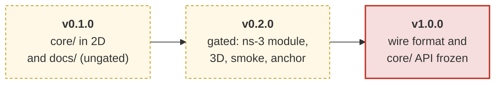
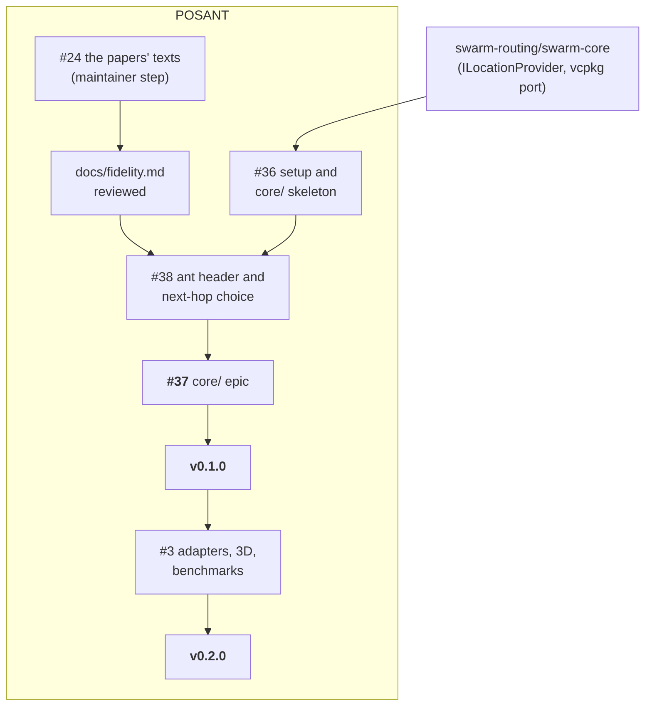

# Roadmap

POSANT's release ladder in one page. The org adopted the ladder on 2026-11-11
(maintainer decision: "adopt the release ladder and replace the phase-targets
rule"); the shape is AntHocNet's
[`docs/roadmap.md`](https://github.com/swarm-routing/AntHocNet/blob/main/docs/roadmap.md),
as swarm-routing/HOPNET's and swarm-routing/ARA's. The cross-repo release
train is in the
[org ROADMAP](https://github.com/swarm-routing/.github/blob/main/ROADMAP.md).
Issue state is always truer than a checked-in diagram.

## How this plan is tracked

Each issue a release gates carries one **`release:` label**, so every row
below is a live query:

| Release | Board |
|---|---|
| v0.1.0 | [`release:v0.1.0`](https://github.com/swarm-routing/POSANT/issues?q=is%3Aopen+label%3A%22release%3Av0.1.0%22) |
| v0.2.0 | [`release:v0.2.0`](https://github.com/swarm-routing/POSANT/issues?q=is%3Aopen+label%3A%22release%3Av0.2.0%22) |
| v1.0.0 | [`release:v1.0.0`](https://github.com/swarm-routing/POSANT/issues?q=is%3Aopen+label%3A%22release%3Av1.0.0%22) |
| all epics | [`epic`](https://github.com/swarm-routing/POSANT/issues?q=is%3Aopen+label%3Aepic) |

Only issues a release actually gates are labelled; unscheduled work lands when
it lands. Majors are reserved for breaking changes, and 1.0.0 is the stability
promise. Releases are cut on the maintainer's request only.

## Release ladder

Amber is planned; nothing has shipped.

## What blocks what

Solid arrows are hard dependencies; dashed are "informs". Nodes in other
repositories use the cross-repo form.

## What each release must show to ship

| Release | Exit criteria |
|---|---|
| **v0.1.0** "core" | `docs/fidelity.md` reviewed against the texts of both papers ([#24](https://github.com/swarm-routing/POSANT/issues/24)), every row a source, a repo choice or a recorded `unknown`; `core/` implements the paper's algorithm as the sheet records it, in 2D (the slices of the epic [#37](https://github.com/swarm-routing/POSANT/issues/37), first [#38](https://github.com/swarm-routing/POSANT/issues/38)) on swarm-core's ports, green in `core.yml`, installable as the CMake package `posant-core` (its vcpkg port follows the release). Ungated: it has not cleared org golden rule 6, and its notes say so. |
| **v0.2.0** "gated" | The ns-3 module is green on `ns3-dev:latest-{debug,sanitized}`; the 3D generalisation is in with its own fidelity rows (a repo choice); `ProtocolContractTest` and the common wire header ([#3](https://github.com/swarm-routing/POSANT/issues/3)); the per-PR delivery smoke at 20 paired seeds; the anchor reproducing the paper's own trend gives a verdict, PASS or a written infeasibility verdict (org golden rule 6). |
| **v1.0.0** | Wire format and `core/` API frozen; a released run is recorded in the benchmarks global suite. |

## Infrastructure track

Rides along, is labelled by area, and never gates a release: CI hygiene, org
template refreshes (org-bot), settings as code, and the epic lists.

## Deliberate non-goals

- The papers' own curves are not reproduced as data; the anchor is a paired
  run through `swarm-routing/ns3-tools` or a written infeasibility verdict.
- No protocol code before the fidelity sheet is reviewed (AGENTS.md rule 11).
- No 1.0.0 before v0.2.0 has given its gate verdicts.

## See also

- [`fidelity.md`](fidelity.md): the papers, mechanism by mechanism.
- [org ROADMAP](https://github.com/swarm-routing/.github/blob/main/ROADMAP.md): the release train.
- [CONTRIBUTING](https://github.com/swarm-routing/.github/blob/main/CONTRIBUTING.md): invariants, labels, issue shape.
- [AntHocNet roadmap](https://github.com/swarm-routing/AntHocNet/blob/main/docs/roadmap.md): the model for this page.
